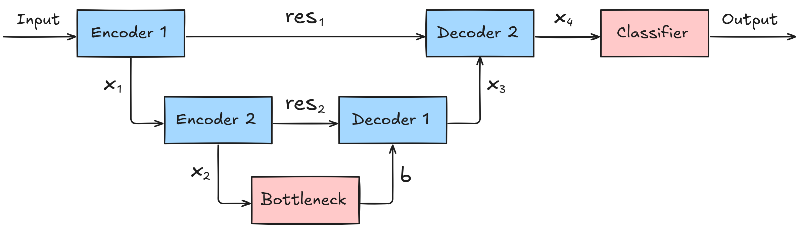
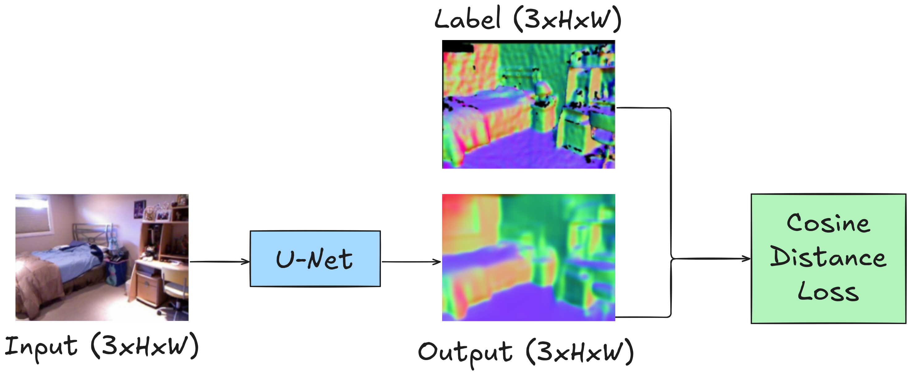
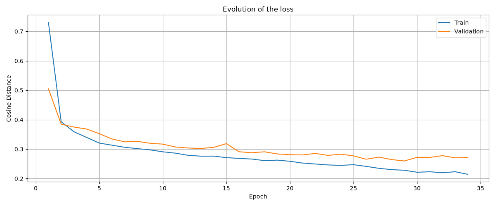
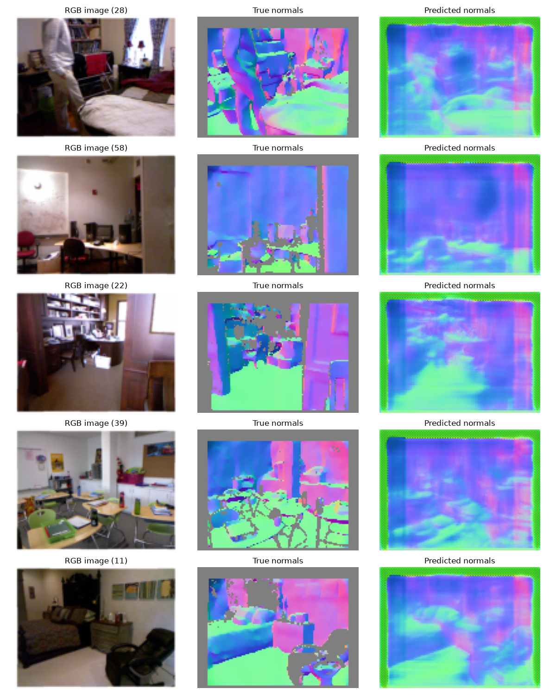
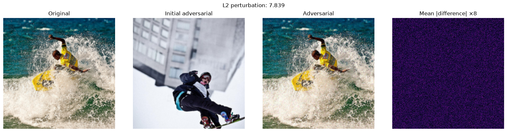

# Computer Vision II: Final Extra Exam

## Introduction

This exam comprises two parts, worth **5 and 4 points respectively** (9 points total + 1 for code quality):

**Part 1: Surface Normals (5 points)** explores **how a computer vision model predicts surface normals from an RGB image**. You will implement a U-Net, two versions of the cosine distance loss, and the training and validation loops. The supplied visualization compares test images, ground-truth normal maps and predicted normal maps.

**Part 2: Adversarial Boundary Attack (4 points)** explores **decision-based adversarial attacks**: changing an input so that a classifier predicts a different class while keeping the change as small as possible. You will implement orthogonal proposal generation, the boundary attack algorithm, and a proposal-distribution attack loop.

Use Python 3.12 or later. To install the dependencies, run `uv sync` from the project directory. The model uses CUDA when available and CPU otherwise.

## Evaluation

The exam will be graded in the following way:

- **Part 1 (5 points)**: Graded by **automatic tests** on surface normal prediction tasks
- **Part 2 (4 points)**: Graded by **automatic tests** on adversarial attack tasks
- **Code style and organization (1 point, common to both parts)**:

    - **Pylint** gives you a mark for your code between $0$ and $10$. If your mark is between $8.5$ and $9.5$, you obtain $0.25$ points, and if it's greater than $9.5$, you obtain $0.5$ points.

    - The remaining $0.5$ points will come from **tools to ensure code quality**. You will have to pass the following formatters and linters: **Black**, **isort**, **Mypy**, **Flake8** and **Complexipy**. If you pass Black, isort and Complexipy, you obtain $0.25$ points, and if you also pass Mypy and Flake8, you obtain the remaining $0.25$ points.

- You will have a **partial view of the tests**, but in the end professors will run all tests created. Therefore, do not just try to pass the tests, but write good code and make sure everything is correct. Moreover, I encourage you to create your own tests.

## Repository structure

```text
final_extra/
├── src/
│   ├── surface/                  # Part 1: Surface Normals
│   │   ├── config.py                 # Supplied paths, model and training settings
│   │   ├── dataset.py                # Supplied NYU Depth V2 loader and preprocessing
│   │   ├── early_stopping.py         # Supplied early stopping and checkpoint saving
│   │   ├── model.py                  # U-Net and supplied prediction method
│   │   ├── loss.py                   # Cosine distance losses
│   │   ├── train.py                  # Training and validation loops
│   │   ├── main.py                   # Supplied training, evaluation and visualization
│   │   └── __init__.py
│   └── adv/                      # Part 2: Adversarial Boundary Attack
│       ├── boundary_attack.py        # Adversarial attack implementation
│       ├── proposal_distribution_attack.py   # Proposal-distribution attack
│       ├── utils.py                  # Supplied image loader and plotting
│       ├── main.py                   # Real-image attack runner
│       └── __init__.py
├── src_uncomplete/               # Student template, distributed as src/
├── scripts/
│   ├── download_dataset.py       # Download and prepare the complete dataset
│   ├── nyuv2_scenes.json         # Scene labels used to reproduce the splits
│   └── README.md                 # Dataset preparation details
├── tests/
│   ├── surface/
│   │   ├── test_dataset.py           # Tests for the dataset loader (Part 1)
│   │   ├── test_early_stopping.py    # Tests for early stopping (Part 1)
│   │   ├── test_download_dataset.py  # Tests for dataset preparation (Part 1)
│   │   ├── test_model.py             # Tests for the U-Net (Part 1)
│   │   ├── test_loss.py              # Tests for losses and gradients (Part 1)
│   │   └── test_train.py             # Tests for training and validation (Part 1)
│   └── adv/
│       ├── test_orthogonal_proposals.py  # Tests for Exercise 2.1 (Part 2)
│       ├── test_boundary_attack.py        # Tests for Exercise 2.2 (Part 2)
│       └── test_proposal_distribution_attack.py  # Tests for Exercise 2.3 (Part 2)
├── data/
│   ├── train/                    # images/ and normals/, 624 PNG pairs (Part 1)
│   ├── val/                      # images/ and normals/, 171 PNG pairs (Part 1)
│   └── test/                     # images/ and normals/, 654 PNG pairs (Part 1)
├── images/
│   ├── readme/                   # Example figures shown below
│   ├── results/                  # Generated training and prediction figures (Part 1)
│   ├── results_adv/              # Adversarial attack results (Part 2)
│   └── coco/                     # COCO images for adversarial attacks (Part 2)
├── weights/                      # Best validation checkpoint (Part 1)
├── Makefile                      # Format, lint and test commands
├── pyproject.toml                # Dependencies and tool settings
├── uv.lock                       # Locked dependencies
└── README.md
```

Running Part 1 writes its figures under `images/results/` and saves the best model weights in `weights/best_model.pt`.
Running Part 2 writes its comparison images to `images/results_adv/`.

## Part 1: Surface Normals (5 points)

### Introduction to Part 1

This part explores **how a computer vision model predicts surface normals from an RGB image**. You will implement a U-Net, two versions of the cosine distance loss, and the training and validation loops. The supplied visualization compares test images, ground-truth normal maps and predicted normal maps.

We use prepared NYU Depth V2 RGB images and their corresponding surface normal maps. Each valid pixel has a three-dimensional normal vector describing the orientation of the surface at that pixel.

Dataset loading, preprocessing, early stopping and visualization are already implemented, but you should inspect them and the data to understand how to connect them to the rest of the code. Complete the `TODO` sections in `src/surface/model.py`, `src/surface/loss.py` and `src/surface/train.py`: nine graded methods, with several placeholders in the U-Net constructor. You cannot modify the surrounding code, including imports, function signatures, configuration or other supplied implementations.

### Dataset and Setup

Use the prepared dataset provided for this exam. To download it yourself, run from the project root:

```bash
uv run scripts/download_dataset.py
```

The full prepared dataset contains **624 training pairs, 171 validation pairs and 654 test pairs**. Training and validation are separated by scene, and the original test set is preserved. Each split has matching files in `images/` and `normals/`, numbered `0.png` through `n-1.png`. For example, `data/train/images/0.png` is paired with `data/train/normals/0.png`. See [scripts/README.md](scripts/README.md) for download details.

The supplied `NYUDepthV2` loader converts the saved PNGs to RGB and returns an image and a normal map, both float tensors shaped `(3, H, W)`. It resizes images with bilinear interpolation and normal maps with nearest-neighbor interpolation. Image values are divided by 255. Normal components are decoded with `RGB / 127.5 - 1` and normalized to unit length. Pixels whose original normal RGB values are all zero are invalid: their decoded vectors remain zero and must be excluded from the loss.

The current configuration uses images of **96 by 128 pixels** and fixed random subsets of **200 training, 75 validation and 75 test images**, selected with seed 42. The downloaded files are not reduced or changed. The loaders use batches of 16; the final batch may be smaller. Both image dimensions must be positive multiples of four so the U-Net skip connections align.

The U-Net receives tensors shaped `(B, 3, H, W)` and produces normal maps with the same shape. Its supplied final normalization acts across channels, producing unit direction vectors for nonzero outputs. Training uses Adam with learning rate `1e-3`, up to 50 epochs, and early stopping with patience 5 and minimum improvement `0.005`. These settings are defined in `src/config.py`.

### Part 1 Exercises

#### Exercise 1.1: U-Net (2 points)

In this exercise you will implement the U-Net in `src/model.py`:



- `EncoderBlock.forward`: Applies the convolution block and returns both the skip-connection features and the pooled features. (0.5 points)

- `DecoderBlock.forward`: Upsamples the input, concatenates the corresponding skip-connection features along the channel dimension, and applies the convolution block. (0.5 points)

- `UNet`: Build the U-Net:

    - `__init__`: Connects two encoders, a bottleneck, two decoders and the final convolution, using the supplied channel sizes `[16, 32, 64]`. (0.5 points)

    - `forward`: Passes the input through these layers and their skip connections. The final channel normalization is already supplied. (0.5 points)

#### Exercise 1.2: Loss Function (1.5 points)

In this exercise you will implement the loss function, the cosine distance, in `src/loss.py`:

$$ \mathcal{L} = \dfrac{1}{HW} \sum_{i=1}^H\sum_{j=1}^W \left( 1 - \dfrac{y_{ij}\cdot\hat{y}_{ij}}{\|y_{ij}\|_2\|\hat{y}_{ij}\|_2} \right) $$

Both implementations receive predictions and targets shaped `(B, 3, H, W)` and return a scalar tensor. Ignore invalid target pixels, protect each norm against division by zero, and preserve gradients for backpropagation. A batch with no valid target pixels must return a differentiable zero loss with zero gradients.

- `CosineDistance.forward`: Computes the cosine distance using loops over samples and pixels. (0.75 points)

- `VectorizedCosineDistance.forward`: Computes the same loss using tensor operations without loops over samples or pixels. (0.75 points)

`USE_VECTORIZED` in `src/config.py` selects the loss used for training and test evaluation. It is `False` in the student template and `True` in the reference implementation. The two versions must agree on both loss values and gradients; the loop version is much slower on full image batches.

#### Exercise 1.3: Training (1.5 points)

In this exercise you will implement the training of the model in `src/train.py`:



- `_train_one_epoch`: Sets training mode, moves batches to the configured device, computes losses and updates the model parameters. Initialize and accumulate `total_loss`; the supplied code records its batch average. (0.5 points)

- `_valid_one_epoch`: Sets evaluation mode and accumulates `total_loss` without updating parameters. Gradient tracking is already disabled by the supplied decorator, and the supplied code records the batch average. (0.5 points)

- `fit`: Runs training and validation for epochs starting at 1, calls early stopping using the latest validation loss, stops when requested, and reports progress with the supplied helper. Restoring the best checkpoint and saving the loss figure are already implemented after the `TODO`. (0.5 points)

### Part 1 Tips

- To train the model, evaluate it on the test split and visualize its predictions, execute:

        uv run python -m src.surface.main

    After completing all exercises, you should see figures like the ones below. The test evaluation prints cosine distance loss, and each visualization row shows the RGB image, true normals and predicted normals. Normal components are mapped from `[-1, 1]` to `[0, 1]` for display; invalid target normals appear gray. Results can vary between runs:

    <center>

    

    </center>

    <center>

    

    </center>

- To check all your code for Part 1, execute:

        uv run pytest tests/surface/

    To check just one part of your implementation, execute the specific test, for example for the model:

        uv run pytest tests/surface/test_model.py

---

## Part 2: Adversarial Boundary Attack (4 points)

### Introduction to Part 2

This part explores **decision-based adversarial attacks**: changing an input so that a classifier predicts a different class while keeping the change as small as possible. The classifier is a black box: the attack uses predicted labels, not gradients or confidence values.

Complete the TODOs in `src/adv/boundary_attack.py` and `src/adv/proposal_distribution_attack.py`. Input preparation, visualization, configuration and test data are supplied.

Given an original input $x$ and adversarial criterion $c$, the objective is to find an adversarial input $\tilde{x}$ that minimizes

$$ \min_{\tilde{x}} \|\tilde{x} - x\|_2^2 \quad \text{subject to} \quad c(\tilde{x}). $$

The code reports ordinary L2 distance; squared and ordinary L2 have the same minimizer.

### Part 2 Exercises

#### Exercise 2.1: Orthogonal proposals (1.2 points)

Implement `orthogonal_proposals` in `src/adv/boundary_attack.py`. Draw
random directions, remove their radial component, scale them with `delta`, and
project candidates onto the sphere centered on the original input. Return the
tangent directions and projected candidates before clipping. Before clipping,
the candidates have the same L2 distance from the original as the current
adversarial input.

For the original input $x$, current adversarial input $\tilde{x}$ and tangent
direction $\eta$, the orthogonality condition is

$$ \eta \cdot (\tilde{x} - x) = 0. $$

After adding the tangent direction, project the candidate $x_s$ onto the
sphere centered at $x$. Before clipping, the projection satisfies

$$ \|x_s - x\|_2 = \|\tilde{x} - x\|_2. $$

The condition applies to the tangent direction, not necessarily to the
displacement after sphere projection or clipping.

#### Exercise 2.2: Boundary Attack (1.6 points)

Implement `BoundaryAttack.attack` and `BoundaryAttack._step_toward_source` in
`src/adv/boundary_attack.py`.
Start with an already-adversarial input. Propose a batch of orthogonal moves,
keep an adversarial candidate, adapt the step size, and try to move toward the
original. Respect the input bounds and stopping limits; return the final input
and statistics in `BoundaryAttackResult`.
Use the supplied `_validate_initial_labels` helper to check the starting labels.
Keep the inward-step logic in `_step_toward_source`, which returns the current
adversarial input, its label, and the updated step size.

#### Exercise 2.3: Proposal-distribution attack (1.2 points)

Implement `ProposalDistributionAttack.attack` in
`src/adv/proposal_distribution_attack.py`. The supplied callback returns
a perturbation `eta`, not a complete candidate. Form `current + eta` and
apply the accept/reject rule. Import `_validate_initial_labels` from
`.boundary_attack` to check the starting labels. By default, accept only
bounded, adversarial candidates that strictly reduce L2 distance. With
`require_improvement=False`, accept bounded adversarial candidates even if
they do not reduce distance.

## Algorithm overview

The Boundary Attack can be summarized as:

```text
classify the original and the initial adversarial input
while the iteration, query and distance limits allow:
    generate and clip a batch of orthogonal candidates
    query their labels and adapt the orthogonal step size
    if no candidate is adversarial:
        continue
    select an adversarial candidate
    try steps toward the original, adjusting the step size
    keep an inward step only if it remains adversarial
return the final adversarial input and statistics
```

The proposal-distribution attack uses a more general accept/reject loop:

```text
classify the original and the initial adversarial input
while the iteration, query and distance limits allow:
    draw a perturbation eta and form candidate = current + eta
    if candidate is outside the bounds:
        continue
    query its label
    if candidate is adversarial and satisfies the configured distance rule:
        current = candidate
return the final adversarial input and statistics
```

`ProposalDistributionAttack` implements that general loop. Its proposal
callback receives the current tensor and a `torch.Generator`, and returns a
perturbation tensor of the same shape. By default, the candidate must also
reduce L2 distance; `require_improvement=False` selects the pseudocode's
adversarial-only acceptance rule. That rule alone does not guarantee
minimization: the proposal distribution must favor lower-distance candidates.

`BoundaryAttack` implements the more specific orthogonal Boundary Attack:
it proposes moves tangent to the sphere around the original input, tests which
remain adversarial, and then tries a step toward the original input. The
orthogonal move and the source-directed step play different roles; an
orthogonal move by itself does not reduce distance to the source.

## Tips (Part 2 - Adversarial)

### Real-image run

After completing the Boundary Attack TODOs, run:

```bash
uv run python -m src.adv.main
```

By default, the runner attacks `0.jpg` using `1.jpg` as the initial adversarial
image, with a 2,500-query budget. It prints the predicted classes, L2 distance
and query count, and saves the comparison to
`images/results_adv/boundary_0_1.png`. The runner downloads pretrained
ResNet-18 weights on first use and selects CUDA if available, otherwise CPU.
CPU runs may take a while. The new result may differ from the saved reference
figure because attack settings and runtime versions affect the search.

To try another pair or save to a different file:

```bash
uv run python -m src.adv.main --source 2 --initial 3 --output images/results_adv/example.png
```

Choose indices from 0 to 3. Use `--max-queries` to change the budget.

A demonstration was run with the repository's COCO test photo `0.jpg` as the
source and `1.jpg` as the initial adversarial input. A cached ImageNet-pretrained
ResNet-18 supplied hard class labels. The source was classified as `paddle`,
the initial image as `ski`, and the final adversarial image as `rock beauty`.
L2 distance decreased from `159.62` to `7.83` within the 2,500-query budget.
This is one untargeted run; the final class need not match the initial
adversarial image's class.



- To check all your code for Part 2, execute:

        uv run pytest tests/adv/

    Or to run a specific exercise test:

        uv run pytest tests/adv/test_orthogonal_proposals.py         # Exercise 2.1
        uv run pytest tests/adv/test_boundary_attack.py              # Exercise 2.2
        uv run pytest tests/adv/test_proposal_distribution_attack.py # Exercise 2.3

### Reference

Reference: [Decision-Based Adversarial Attacks: Reliable Attacks Against
Black-Box Machine Learning Models](https://arxiv.org/abs/1712.04248), by
Wieland Brendel, Jonas Rauber, and Matthias Bethge (ICLR 2018).

---

## Code Quality Guidelines (Common to both parts)

To format the code, run all static checks, execute the tests, or run everything together, use:

```bash
make format
make lint
make test
make check
```

The supplied `make lint` command also runs Bandit and Ruff. Keep your changes inside the TODO blocks when applying formatting tools.
